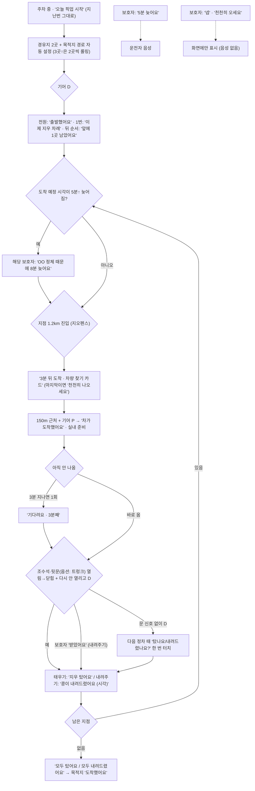

# 픽업 체크인 — 기획서

> **기다리는 사람을 안심시키는 차.**
> 여러 곳에 서서 태우고 내려주는 **정차형 픽드랍**마다, 차가 탑승·인계·지연·대기를 알아채고 기다리는 사람에게 대신 연락한다. 운전자는 주행 중 아무것도 누르지 않는다.
> "운전하는 사람이 손 하나 안 대도, 기다리는 사람이 내 차례를 먼저 안다."

- 공모전: 현대자동차그룹 차량용 앱 개발 공모전 (Pleos Connect) · 분야: **가족·동승자 케어 / 픽업**
- 문서 버전: **v1.1 (2026-11-10)** · v1.0 대비: 반려견 유치원 픽드랍(B2B 첫 시장), 드랍(인계) 판정, 순서 공유, 보호자 빠른 답장 추가
- 앱 이름: **픽업 체크인**
- 근거 문서: [`PRD.md`](PRD.md), [`SDK_실측결과.md`](SDK_실측결과.md), 프로토타입 = 이 저장소

---

## 1. 문제

### 장면 A — 학원 픽업 (데모 주인공)
맞벌이 부모는 주 3~5회, 우리 아이와 옆집 아이를 학원에서 태운다. 운전하는 동안 이런 연락이 오간다.

| 누가 | 무엇을 묻나 | 지금은 |
|---|---|---|
| 기다리는 아이 | "엄마 어디야? 언제 와?" | 운전 중 전화를 받거나 못 받음 |
| 옆집 엄마 | "하윤이 탔어요?" | 정차해서 단톡방에 "태웠어요" 입력 |
| 운전자 | "길 막히는데 늦는다고 말해야 하나" | 운전하면서 카톡을 칠 수 없음 |
| 운전자 | "아이가 아직 안 나왔네, 몇 분째지?" | 학원 앞에서 기다리며 전화 |

### 장면 B — 반려견 유치원 픽드랍 (실제 기사↔견주 문자)
같은 일을 **매일, 직업으로** 하는 사람들이 있다. 아래는 실제 반려견 유치원 기사가 견주에게 보낸 문자다.

> "저 도착했는데 문자를 안 보내드렸네요, 잠시만요 금방 갈게요!"
> "아주 천천히 내려오세요 토리가 마지막이에요"
> "5분 후 도착합니다" → "넵"
> "10분 후 도착합니다"
> "오늘 토리가 마지막이라 좀 늦을 거 같아요~" → "넵 천천히 오세요"

| 문자에 담긴 것 | 문제 | 픽업 체크인이 대신하는 것 |
|---|---|---|
| "도착했는데 문자를 안 보냈네요" | 운전·정차 중 수동 문자 → **깜빡함** | 지오펜스 도착 시 자동 "도착했어요" |
| "5분/10분 후 도착합니다" | 매일 반복되는 수동 도착 예정 안내 | 지오펜스 접근 시 자동 "3분 뒤 도착해요" |
| "토리가 마지막이에요, 천천히 내려오세요" | 순서를 알아야 언제 내려갈지 정함 | **순서 공유**: "토리 앞에 1곳 남았어요. 토리가 마지막이에요" |
| "마지막이라 좀 늦을 거 같아요" | 지연 사유와 함께 미리 알림 | 정체로 5분↑ 늦어지면 자동 "10분 늦어요" |
| "넵", "천천히 오세요" | 운전 중 답장을 읽어야 함 | 보호자 **빠른 답장**은 음성으로 읽지 않고 화면에만 |

> 이 앱을 만든 계기: 구로디지털단지역과 잠실에서 친구들을 차례로 태워 원주로 가던 날, 운전하며 "어디쯤이야, 탔어, 다음은 누구야"를 계속 연락해야 했다. 학원 픽업과 반려견 유치원 기사의 문자에서 같은 문제가 매일 반복되는 것을 확인했다.

---

## 2. 해결: 핵심 경험 세 가지

하나의 가치("기다리는 사람을 안심시킨다")를 세 순간에 적용한다. 정차 지점마다 **태우기(PICKUP)인지 내려주기(DROPOFF)인지**만 다르고 같은 상태 머신이 처리한다.

### ① 탔어요 / 내려드렸어요 — 승하차를 차가 확인해 대신 알린다
- **태우기:** 정차(P) 중 조수석·뒷문이 **열렸다 닫히고**, 다시 열리지 않은 채 **출발(D)**하면 탑승 확정 → 보호자에게 **"지우 탔어요"**
- **내려주기:** 같은 신호로 인계 확정 → **"콩이 내려드렸어요 (8:02)"**. 보호자가 웹에서 **"받았어요"**를 누르면 그 즉시 확정한다(문만 열고 안 내린 경우를 문·기어로는 구분할 수 없으므로 보호자 확인을 근거로 씀)
- 반려견 켄넬을 트렁크로 싣는 운영자는 트렁크 열림·닫힘도 인정 (플랜 옵션)
- 운전자는 음성으로 "지우 탔어요. 다음은 하윤, 도곡동 피아노학원"만 듣는다

### ② 늦어요 — 차막힘을 차가 감지해 미리 알린다
- 다음 지점으로 출발할 때의 도착 예정 시각을 기준으로, 정체로 **5분 이상 늦어지면** 그 지점 보호자에게 자동 연락
  - 태우기: "강남대로 정체 때문에 8분 늦어요. 하윤은 학원 안에서 기다려 주세요"
  - 내려주기: "정체 때문에 10분 늦어요. 토리와 같이 가고 있으니 천천히 준비하세요"
- 3분 이상 더 늦어질 때만 다시 알리고, 3분 전 알림 이후에는 보내지 않는다 (알림 폭탄 방지)
- 반대 방향: 보호자가 "5분 늦어요"를 누르면 운전자에게 **음성으로만** 전한다

### ③ 기다려요 — 기다리는 시간과 순서를 양쪽 모두 안다
| 상황 | 차가 하는 일 |
|---|---|
| **차례를 기다림** | **순서 공유**: 앞 지점으로 출발할 때 뒤 순서들에 "토리 앞에 1곳 남았어요". 마지막이면 "토리가 마지막이에요. 천천히 나오세요". 다른 집 이름·주소는 노출하지 않고 숫자만 |
| **차가 오는 중** | "3분 뒤 도착해요 · 흰색 아이오닉 5 · 학원 정문 앞 비상등 켠 차" (차량 찾기 카드) |
| **차가 먼저 도착** | 3분이 지나면 "엄마 차가 정문 앞에서 기다려요 · 3분째"를 **한 번만** (반복 알림 없음). 운전자에게는 음성 한 번만 |
| **대기 중 실내 준비** (주차 중) | 실내 온도·무드등을 미리 맞춤 (공조·조명 set→get 실측) |
| **너무 오래 기다림** | 10분이면 주차 중 화면에 "보호자에게 알리기 / 계속 기다리기" 한 번 |
| **보호자 빠른 답장** | "넵", "천천히 오세요"는 **운전자에게 읽어주지 않고** 화면에만 표시 (확인만 하면 되는 정보라 주의 분산을 막음) |

> 내부 검토에서 "기능을 붙이는 순간 산만해진다"는 지적이 있어, 새 기능은 모두 **같은 상태 머신의 문구·상태 확장**으로만 넣었다. 새 화면이나 새 입력은 없다.

---

## 3. 사용자 흐름



---

## 4. 차량 특화성: 차만 아는 것으로 판단한다

| 판단 | 사용하는 차량 신호 | 폰으로 가능한가 |
|---|---|---|
| 탔다 / 내렸다 | 정차(P) + 조수석·뒷문(·트렁크) 열림→닫힘 + 출발(D) | ❌ 폰은 문과 기어를 모름 |
| 차가 도착해 기다리는 중 | 지오펜스 진입 + 정차(P) 지속 시간 | △ 위치만으로는 지나가는 중과 구분 어려움 |
| 늦어진다 | 차량 내비의 경로·정체·도착 예정 시각 | △ |
| 순서 | 차가 경유지 진행 상태를 앎 | △ 기사가 직접 입력해야 함 |
| 주행 중에는 묻지 않는다 | 기어 상태로 UI 입력 차단 | ❌ |
| 대기 중 실내 준비 | 공조·앰비언트 조명 제어 | ❌ |

**주행 중 운전자 입력 0회.** 안내는 음성 한 문장씩, 화면 입력은 주차(P) 중에만.
반려견처럼 착좌 센서에 잘 안 잡히는 대상에서도 **문+기어 판정이 그대로 동작**한다 (착좌는 반려견 플랜에서 끔 — 켄넬·가방 오판정 방지).

---

## 5. 기술 활용 (Pleos SDK)

| 기능 | SDK / API | 에뮬레이터 실측 |
|---|---|---|
| 출발·정차 | `Vehicle.getGear().registerGearSelection` | ✅ |
| 승하차 후보 | `Vehicle.getDoor().registerDoorPosition` (조수석·뒷문, 옵션: 트렁크 `DoorArea.REAR`) | ✅ 뒷문·트렁크 열림→닫힘 |
| 보조 신호 (탑재 차량) | `Seat.registerSeatOccupancy`, `registerSeatBeltBuckledState` — 방향 아닌 변화만 | ⚠️ 에뮬레이터 불안정 → 데모에서 끔 |
| 경로 설정 | `NaviHelper.requestRouteWithWaypoints` (최대 2곳 → 2곳씩 롤링) | ✅ 내비 화면에 경로 표시 확인 |
| 남은 시간·정체 | `getWaypointInfo().remainTime`, `onDrivingInfo`, `RouteStateInfo.trafficStatus`, `requestTrip` | ✅ 수신 (값은 목업) |
| 접근·도착 | `FusedLocation.addProximityAlert` (1.2km / 150m) | ✅ |
| 음성 안내 | `TextToSpeech` ON_DEVICE | ✅ |
| 대기 중 실내 준비 | `HVAC.setHvacTemperature`, `Light.setAmbientLight*` | ✅ 23.0°C·무드등 60 재조회 확인 |
| 보호자 알림·답장 | 자체 중계 서버 + 설치 없는 모바일 웹 | ✅ |

### 실제 신호와 데모 주입 (정직하게 구분)
| 장면 | 시연 방식 | 이유 |
|---|---|---|
| 기어·문·트렁크 | **실제** (가상 콘솔 → Vehicle SDK) | |
| 접근·도착 | **실제** (GPS 이동 → 지오펜스) | 에뮬레이터 내비는 위치 고정 목업 |
| 실내 준비 | **실제** (HVAC·Light set → get) | |
| 차막힘 지연 | **DEMO 주입** (라벨 표시) | 에뮬레이터 정체 값 고정. 실차는 내비 ETA |
| 대기 3분 경과 | **DEMO 주입** (시간 앞당김) | 발표에서 3분을 기다릴 수 없음 |

### 구조
```
Vehicle SDK ─┐                     ┌─▶ TTS (운전자 음성)
NaviHelper ──┼─▶ PickupEngine ─────┼─▶ 중계 서버 → 보호자 웹 (탔어요·내려드렸어요·늦어요·기다려요·순서)
FusedLocation┤   (순수 Kotlin,      ├─▶ 경로 설정 (2곳씩 롤링)
보호자 웹 ───┤    정차 유형          └─▶ 주차 중 확인 질문
DEMO 주입 ───┘    PICKUP/DROPOFF)
        ▲ 포그라운드 서비스가 보유 (내비가 앞에 있어도 동작)
```
- 상태 머신은 안드로이드 의존성이 없고 **단위 테스트 25개**로 검증: 승하차 판정, 짐만 싣기, 문 다시 열기, 주행 중 문 무시, 근처+P 도착, 한 지점 2명(보호자 다름·형제), 3곳 롤링, 지연 임계·재알림·억제, 대기 1회 알림·긴 대기, **드랍 인계·보호자 확인·트렁크·순서 공유(이름 비노출)·빠른 답장 무음성·반려견 착좌 무시**.

### 승하차 판정과 오판정 대응
| 상황 | 처리 |
|---|---|
| 트렁크에 가방만 싣고 닫음 | 기본은 트렁크 제외 (켄넬 운영자 플랜만 포함) |
| 문을 닫았다가 다시 엶 | 그 문의 사이클 무효 |
| 문만 열고 안 내림 (드랍) | 보호자 "받았어요"가 없으면 출발 후 "확인 필요" → 다음 정차 때 한 번 터치 |
| 문 신호 없이 출발 | "확인 필요" → 다음 정차 때 질문 |
| 지점 근처 진입만 함 | 도착 아님. 근처 + 기어 P일 때만 "도착·대기" |
| 한 지점 2명 | 보호자가 같으면(형제) 함께 확정. 보호자가 다르면 자동 확정하지 않고 다음 P에서 확인 |
| 주행 중 문 이벤트 / 운전석 문 | 무시 |
| 착좌 센서 없음·값 이상·반려견 | 문과 기어만으로 판정 |

---

## 6. 차별점

| | 위치 공유 앱 | 단톡·문자 | 학원 차량 알림 앱 | **픽업 체크인** |
|---|:-:|:-:|:-:|:-:|
| 차가 어디쯤인지 | ✅ | ❌ | ✅ | ✅ |
| **탔는지·내렸는지** | ❌ | 기사가 직접 입력 | 기사가 직접 입력 | ✅ **차가 판정** |
| **늦어질 때 미리 알림** | ❌ | 직접 입력 | △ | ✅ 자동 |
| **내 순서** | ❌ | 기사가 직접 | △ | ✅ 자동 (숫자만) |
| 차가 기다리는 중인지 | △ | ❌ | ❌ | ✅ 대기 시간 포함 |
| 운전 중 입력 | 필요 | 필요 | 필요 | **0회** |

- 사내 해커톤 수상작 '마중'(기능 비공개)과의 차이: 한 사람을 맞으러 가는 것이 아니라, **여러 곳을 순서대로 태우고 내려주며 승하차·지연·대기·순서를 차가 판정해 대신 연락**한다.
- 테슬라 Dog Mode와의 차이: **"Dog Mode는 차 안에 남겨진 개를 지키고, 우리는 기다리는 사람에게 알려준다."**

---

## 7. 사업성

### 시장 정의: 정차형 픽드랍 운영자
하루에 여러 곳을 서서 태우고 내려주는 운전자는 지금 운전 중에 직접 문자를 보낸다. 픽업 체크인은 이 일을 차가 대신한다.

| 순서 | 고객 | 누가 내나 | 빈도 | 근거 |
|---|---|---|---|---|
| **1. 첫 매출 (B2B)** | **반려견 유치원 픽드랍** | 유치원이 **차량당 월 1만 원** (팀 PRD 기준, 무료 체험 1개월. 내부 검토의 지불 의향 추정은 1.5~2만 원) | 영업일 매일 × 픽업·드랍 2회 | 실제 문자 장면. 영세하고 쓰는 도구가 없음 |
| 2. 습관 형성 (B2C) | 학원 반복 픽업 가족 | 가족 구독 월 2~3천 원 | 주 3~5회 | 데모 주인공 |
| 3. 확장 (B2B) | 학원 셔틀, 주간보호센터, 소상공인 자가 배송(트렁크 판정) | 운영자 | 매일 | 같은 엔진, 플랜만 변경 |
| + | HMG 커넥티드 서비스 번들 | — | — | 리텐션 지표 + 승하차 기록 |

### 확산 구조
- **계약 1곳 = 보호자 수십 명.** 유치원 1곳이 견주 10~20명(확인 필요)에게 링크를 보낸다. 보호자는 설치 없이 웹으로 참여하므로 영업 비용 없이 퍼진다.
- Pleos 보급 초기에도 **차 1대가 여러 가정을 연결**한다.
- 쌓인 승하차 시각·인계 기록은 **운송 이력 증빙**이 된다.

### 사업성 핵심 문장
> 학원·반려견 유치원처럼 하루에 여러 번 서는 '정차형 픽드랍' 운영자는 지금 기사가 운전 중에 직접 문자를 보냅니다. 픽업 체크인은 이 일을 차가 대신해, 계약 1곳으로 보호자 수십 명에게 닿습니다.
> 가족 구독으로 습관을 만들고, 차량당 월 과금 B2B로 돈을 법니다. 쌓인 승하차 기록은 운송 이력 증빙이 되어 HMG 커넥티드 번들의 근거가 됩니다.

### 넣을 숫자 (확인 필요)
- 통계청·교육부 「초중고 사교육비 조사」 참여율·주당 횟수
- 반려견 유치원 수, 유치원당 픽드랍 이용 견주 수, 차량 중 HMG 차량 비중
- 학부모·견주 설문 20~30명 (픽업 1회당 연락 횟수, 지불 의사)

### 로드맵
| 단계 | 대상 | 감지 신호 |
|---|---|---|
| 1 | 학원 픽업 + 반려견 유치원 픽드랍 (지금) | 문·트렁크 + 기어 + 지오펜스 + 정체 |
| 2 | 친구·가족 다인 픽업, 출퇴근 카풀 | 동일 |
| 3 | 소상공인 자가 배송 | 트렁크 (적재·전달) |
| 4 | 학원 셔틀·주간보호센터·수요응답형 셔틀 | 좌석별 착좌 |
| + | 가족 목소리 안내, 반복 일정("지난번 그대로"), 월간 픽드랍 리포트 | TTS 화자 설정 등 |

---

## 8. 개인정보와 안전

- **아이·반려견 개인의 위치는 따로 수집하지 않는다.** 차량 위치와 경유지는 접근·도착·지연 판단에 쓰지만, 보호자에게 보내는 것은 차의 상태 이벤트("탔어요", "내려드렸어요", "8분 늦어요", "기다려요")뿐이고 실시간 차량 좌표는 공개하지 않는다. 차량 위치 처리와 아동 정보 관련 법정대리인 고지·동의 요건은 법률 확인 필요.
- 순서 공유는 **숫자만** ("앞에 1곳 남았어요"). 다른 집 이름·주소는 노출하지 않는다.
- 보호자 웹 링크는 그날 픽드랍이 끝나면 더 이상 정보를 보여주지 않는다.
- 문구는 사람 말투로. 쓰지 않는 문구: "탑승이 감지되었습니다"(감시 느낌), "탑승자 1/3 완료"(숫자로 셈), "차량이 목적지에 도착하였습니다. 탑승을 확인해 주세요"(기계 말투).
- 주행 중 화면 입력 0회, 확인 질문은 주차 중에만, 확인성 답장은 음성으로 읽지 않음.

---

## 9. 개발 현황 (2026-11-10)

| 항목 | 상태 |
|---|---|
| 차량 앱 (`pickup-checkin/`) | ✅ 빌드 성공. 신호 처리는 포그라운드 서비스 |
| 상태 머신 + 단위 테스트 | ✅ **25개 통과** |
| 보호자 웹 + 중계 서버 | ✅ 상태 화면, "5분 늦어요", 빠른 답장 "넵/천천히 오세요", 드랍용 "받았어요" |
| 데모 자동화 | ✅ `scripts/demo.sh`(학원), `scripts/demo_pet.sh`(반려견 하원 드랍) |
| 에뮬레이터 전 장면 실행 | ✅ 학원·반려견 모두 동작 확인 |

### 학원 픽업 실행 결과 (요약)
`출발 → 지우 '이제 지우 차례' · 하윤 '앞에 1곳 남았어요' → 지오펜스 '3분 뒤 도착' → '차가 도착했어요' + 실내 23.0°C → 뒷문+D '지우 탔어요' → DEMO 정체 '8분 늦어요' → 보호자 '5분 늦어요'→운전자 음성 → '기다려요 · 3분째' → '하윤 탔어요' → '모두 탔어요' → '집에 도착했어요'`

### 반려견 유치원 하원 드랍 실행 결과 (2026-11-10 23:23)
| 신호 | 결과 |
|---|---|
| 출발 (REAL 기어) | 콩이 "이제 콩이 차례예요", 토리 **"토리 앞에 1곳 남았어요. 토리가 마지막이에요. 천천히 나오세요"** |
| 지오펜스 접근·도착 (REAL) | 콩이 "3분 뒤 콩이네 아파트에 도착해요", "해피독 선생님이 콩이와 기다리고 있어요 · 101동 1층 공동현관" |
| 콩이 보호자 웹 **"받았어요"** | 즉시 **"콩이 내려드렸어요 (23:23)"** · 근거 `GUARDIAN_CONFIRMED` |
| 토리 보호자 **"넵"**, **"천천히 오세요"** | 💬 화면에만 표시, **음성 안내 없음** |
| DEMO 정체 +10분 | 토리 "정체 때문에 10분 늦어요. 토리와 같이 가고 있으니 천천히 준비하세요" |
| DEMO 대기 3분 | "해피독 선생님이 … 토리와 기다려요 · 3분째" |
| REAL **트렁크(켄넬)** 열림→닫힘 + D | **"토리 내려드렸어요"** · "모두 내려드렸어요. 해피독 유치원으로 출발합니다" |

### 실행 중 발견해 고친 문제
- 앱이 백그라운드로 가면 약 24초간 이벤트가 밀림 → 포그라운드 서비스로 이전
- 데모 좌표가 지오펜스 안이라 지연 알림이 억제됨(설계대로) → 좌표 수정
- 에뮬레이터 네트워크가 끊기면 보호자 웹 연결 실패 → **`adb reverse`로 PC 중계 서버에 직접 연결** (발표장 네트워크 문제에도 안전)

---

## 10. 리스크와 확인할 것

| 리스크 | 대응 |
|---|---|
| 에뮬레이터 내비 목업 | 도착은 지오펜스 실제 신호, 지연·대기만 DEMO 주입 표기. 운영사무국에 모의 주행 문의 |
| 착좌 신호 불안정 | 문+기어 중심 판정 (반려견 플랜은 착좌 끔) |
| 경유지 최대 2곳 | 2곳씩 롤링 (테스트 검증) |
| **반려견이 무대에 오르면 Dog Mode 연상·짬뽕 인상** | **데모 주인공은 학원 하나**. 반려견은 사업성 슬라이드(실제 문자 증거) + 마지막 10초 "같은 엔진, 플랜만 바꾸면" 장면으로만 |
| **동물운송업 등록** (유상 반려동물 운송) | 우리는 SaaS 제공자. 고객사(유치원) 해당 여부 **확인 필요**. 승하차 기록이 운송 이력 증빙에 도움 |
| 고객사 차량이 Pleos 탑재 차량이어야 함 | 유치원 차량 중 HMG 차량 비중·Pleos 보급 일정 **확인 필요** |
| 견주는 웹 푸시를 잘 안 봄 | 카카오 알림톡 연동 검토 (12/3 이후) |
| '마중'과 겹침 | 6장 비교표 |
| 아동 정보 법적 요건 | 위치 미수집, 이벤트만, 법률 확인 |

---

## 11. 발표 구성 (안)

| 시간 | 내용 |
|---|---|
| 0:00 | 문제: 학원 픽업 엄마의 운전 중 연락 + **반려견 유치원 기사의 실제 문자 캡처** |
| 0:40 | 한 줄 가치 · 핵심 경험 ①②③ |
| 1:00 | **데모 (학원)**: 차량 화면 + 보호자 폰 2대 분할화면 — 탔어요 → 정체 8분 늦어요 → 기다려요 → 모두 탔어요 |
| 2:30 | 실제 신호 vs DEMO 주입 표, 상태 머신·테스트 25개 |
| 3:00 | **10초 클로징**: 플랜만 바꿔 반려견 하원 드랍 — "토리가 마지막이에요", "받았어요" → "토리 내려드렸어요" |
| 3:15 | 사업성: 정차형 픽드랍 운영자, 차량당 월 과금, 계약 1곳 = 보호자 수십 명 |

## 12. 일정
| 날짜 | 할 일 |
|---|---|
| ✅ 11/9~10 | 포그라운드 서비스, 대기 경험, 반려견 드랍·순서 공유·빠른 답장, 에뮬레이터 실행 |
| 11/11~12 | 분할화면 녹화 (학원 메인 + 반려견 10초), README·GitHub 정리 |
| 11/13~14 | 접수 양식 옮기기, 통계·설문 숫자, 동물운송업·Pleos 보급 확인 |
| **11/15** | **1차 제출** |
| ~12/3 | 반복 일정, 초대 링크, 알림톡, 실사용자(유치원 1곳) 피드백 |
