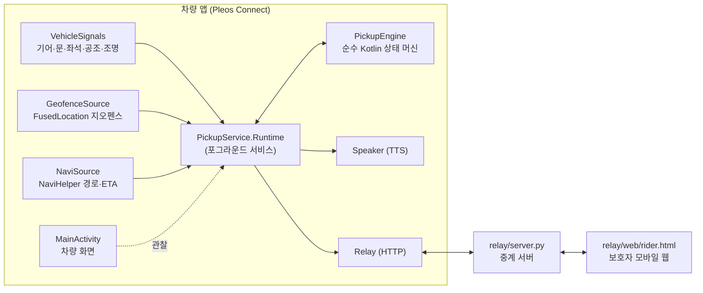
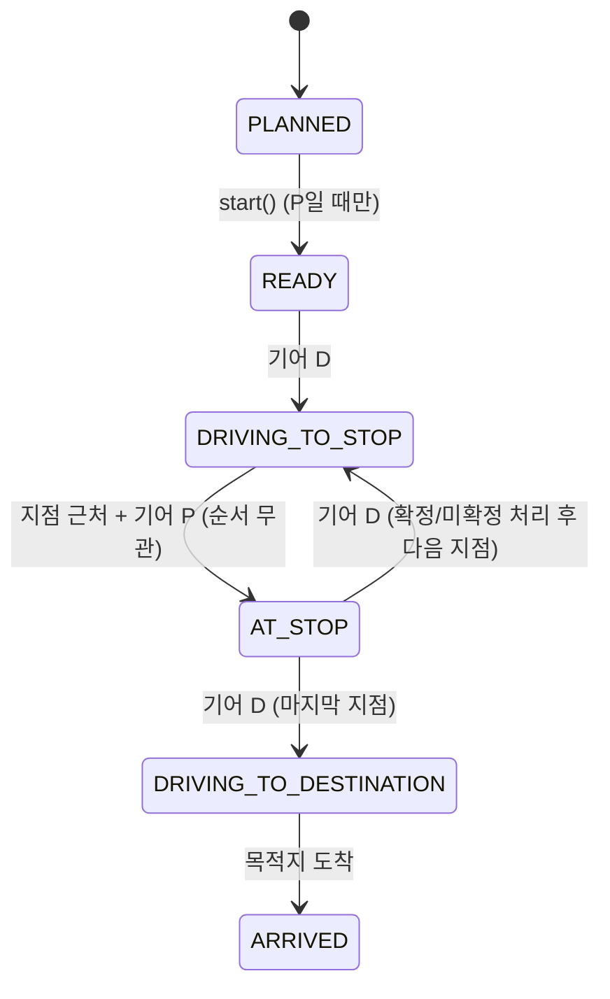

# 픽업 체크인 — 소스 설명

이 문서는 코드를 처음 보는 사람이 **어디서 무엇을 판단하는지** 빠르게 찾도록 정리한 안내서입니다.
실행 방법은 [`../README.md`](../README.md), 기획은 [`기획서.md`](기획서.md), SDK 실측은 [`SDK_실측결과.md`](SDK_실측결과.md)를 보세요.

## 1. 한눈에 보는 구조

**설계 원칙 세 가지**

1. **판단은 한 곳에서만.** 탑승·하차·지연·대기·순서 판단은 전부 `core/PickupEngine.kt`에 있습니다. 안드로이드 의존성이 없어서 JVM 단위 테스트로 검증합니다.
2. **입력과 출력은 어댑터가.** SDK 콜백은 `car/`의 어댑터가 받아 엔진 메서드(`onGear`, `onDoor`, `onArrivedAtStop` 등)로 넘깁니다. 엔진은 `Effect`(말하기·알리기·경로 설정…)만 내보내고, 실제 SDK·네트워크 호출은 서비스가 합니다.
3. **실제 신호와 데모 주입이 같은 입구.** 에뮬레이터에서 재현할 수 없는 신호(내비 정체, 대기 시간)도 같은 엔진 메서드로 들어갑니다. 그래서 데모와 실차의 판단 로직이 같습니다.

## 2. 폴더와 파일

| 파일 | 역할 |
|---|---|
| `core/Model.kt` | 데이터 모델. `Plan`(운행) · `Stop`(지점, `PICKUP`/`DROPOFF`) · `Rider`(아이·반려견, 보호자) · `Phase` · `RiderStatus` · `Evidence`(확정 근거) · `Effect`(엔진 출력) |
| `core/PickupEngine.kt` | **상태 머신.** 모든 판단 규칙 (아래 3장) |
| `core/PlanJson.kt` | `assets/plans/*.json` ↔ `Plan` 변환 |
| `car/VehicleSignals.kt` | Vehicle SDK: 기어, 문 5곳(운전석·조수석·뒷문 2·트렁크), 좌석 착좌·벨트(2초 폴링 병행), 실내 준비(HVAC 온도·무드등 set → get 재확인) |
| `car/ArrivalSources.kt` | `GeofenceSource`: 지점마다 접근 1.2km·도착 150m 지오펜스. `NaviSource`: 경유지 경로 설정, 경유지 도착·남은 시간·정체 (에뮬레이터에선 목업이라 이벤트는 끔) |
| `car/Speaker.kt` | TextToSpeech ON_DEVICE. 초기화 전 문장은 큐에 쌓았다가 순서대로 말함 |
| `car/PickupService.kt` | 포그라운드 서비스. `Runtime`이 엔진과 어댑터를 묶고, `Effect`를 실제 호출로 바꿈. 5초 틱(대기 타이머), DEMO 명령 처리 |
| `net/Relay.kt` | 중계 서버 클라이언트. 차 → 보호자(`/api/plan`, `/api/events`), 보호자 → 차(`/api/inbox` 2초 폴링: "늦어요", 빠른 답장) |
| `ui/MainActivity.kt` | 차량 화면. 서비스 상태를 관찰해 표시만 함. 주행 중 입력 없음, P일 때만 확인 버튼. 하단 DEMO 패널 |
| `assets/plans/` | `academy.json`(학원 2곳), `pet.json`(반려견 하원 드랍, 트렁크 포함), `friends.json` |
| `relay/server.py` | Python 표준 라이브러리 HTTP 서버. 이벤트·플랜·받은편지함 보관 |
| `relay/web/rider.html` | 보호자 웹(설치 없음). 자기 아이 소식만 표시, "넵 / 천천히 오세요 / 받았어요 / 늦어요" 버튼 |
| `scripts/demo*.sh` | 가상 콘솔 HTTP API + `adb emu geo fix` + DEMO 주입으로 전 과정 자동 시연 |

## 3. 상태 머신 (`PickupEngine`)

### 운행 단계 (`Phase`)

### 탑승·하차 판정

| 단계 | 조건 | 코드 |
|---|---|---|
| 후보 | `AT_STOP` + 기어 P + 조수석·뒷문(켄넬 플랜은 트렁크도) **열림→닫힘** | `onDoor()` |
| 무효 | 같은 문이 다시 열림 / 주행 중 문 이벤트 / 운전석 문 | `onDoor()` |
| 확정 | 후보 상태에서 기어 D 출발 → `BOARDED` 또는 `DROPPED`, 근거 `DOOR_CYCLE_THEN_DRIVE` | `onDepart()` → `complete()` |
| 즉시 확정 | 착좌·벨트 값 **변화**(방향 무관, 실차에서만 켬) / 드랍에서 보호자 "받았어요" | `onSeatOrBeltChanged()`, `onRiderReply()` |
| 한 지점 여러 명 | 보호자가 같으면(형제) 함께 확정, 다르면 누구인지 모르므로 `UNCONFIRMED` | `autoConfirmable()` |
| 미확정 | 문 신호 없이 출발 → `UNCONFIRMED` → 다음 P에서 운전자에게 한 번 질문 | `onPark()` → `AskDriver` |

### 알림 규칙

| 알림 | 규칙 | 상수 |
|---|---|---|
| 곧 도착 | 남은 시간 3분 이하(지오펜스 1.2km 또는 내비) 지점당 1회 | `SOON_SECONDS = 180` |
| 지연 | 출발 후 첫 ETA를 기준으로 5분 이상 늦으면 해당 지점 보호자에게만 | `LATE_SECONDS = 300` |
| 지연 재알림 | 이미 알린 지연보다 3분 이상 더 늦을 때만, 곧 도착 이후엔 중단 | `RENOTIFY_SECONDS = 180` |
| 대기 | 차가 먼저 와서 3분 지나면 보호자에게 1회, 10분이면 P 중 운전자에게 한 번 질문 | `WAIT_NOTIFY_SECONDS`, `LONG_WAIT_SECONDS` |
| 순서 | 다음 지점 출발 시 뒤 순서 보호자에게 "앞에 N곳" (다른 집 이름 없음), 마지막 순서엔 "천천히 나오세요" | `announceNext()`, `lastNote()` |
| 빠른 답장 | "넵", "천천히 오세요"는 화면에만(음성 없음), "늦어요"만 짧게 음성 | `onRiderReply()`, `onRiderLate()` |
| 경로 | NaviHelper 경유지는 최대 2곳 → 2곳씩 롤링으로 다시 설정 | `WINDOW = 2`, `requestRouteWindow()` |

## 4. Pleos SDK 사용 위치

| SDK | API | 파일 | 쓰는 곳 |
|---|---|---|---|
| Vehicle 2.3.2 | `Gear.registerGearSelection` | `VehicleSignals` | 출발·정차, 확정 시점 |
| | `Door.registerDoorPosition` (5개 영역) | `VehicleSignals` | 탑승·하차 후보 |
| | `Seat.registerSeatOccupancy`, `registerSeatBeltBuckledState`, `getCurrentSeatOccupancy` | `VehicleSignals` | 보조 확정 신호(실차) |
| | `HVAC.setHvacTemperature`, `Light.setAmbientLightSwitch/Brightness` + get | `VehicleSignals.prepareCabin()` | 대기 중 실내 준비 |
| FusedLocation 1.1.3 | `addProximityAlert` (ENTER) | `GeofenceSource` | 접근 1.2km · 도착 150m · 목적지 |
| NaviHelper 3.0.5 | `requestRouteWithWaypoints` (FIRST·SECOND) | `NaviSource.setRoute()` | 경유지 경로 |
| | `onWayPointArrived`, `onWayPointInfo.remainTime`, `onRouteStateInfo.trafficStatus` | `NaviSource` | 실차 도착·ETA·정체 (에뮬레이터 목업이라 끔) |
| TextToSpeech 3.3.1 | `TextToSpeech(ON_DEVICE).speak` | `Speaker` | 운전자 안내 (주행 중 유일한 출력) |

매니페스트에는 SDK 문서에 있는 퍼미션만 선언했습니다(`PRIVATE_CAR_*` 미사용).

## 5. 한 장면의 코드 흐름 예: "지우 탔어요"

1. 가상 콘솔에서 뒷문 열림·닫힘 → `VehicleSignals`의 `DoorPositionListener` → `engine.onDoor(REAR_LEFT, open)`
2. 엔진: `AT_STOP` + P 확인 → 지우 상태 `CANDIDATE` (아직 알리지 않음)
3. 기어 D → `engine.onGear(DRIVE)` → `onDepart()` → `complete()` → `Effect.Notify("jiwoo", "boarded", "지우 탔어요.")` + `Effect.Say("지우 탔어요.")`
4. `PickupService.Runtime.handle()` → `relay.postEvent()`(보호자 웹) + `speaker.say()`(차 음성)
5. 보호자 웹이 `/api/state`를 1초마다 읽어 배지 "탔어요"로 표시

## 6. 테스트

`./gradlew :app:testDebugUnitTest` — `app/src/test/.../PickupEngineTest.kt`, 25개. 시계(`now`)를 주입해 3분·10분 대기도 즉시 검증합니다.

- 정상 흐름, 착좌 변화 즉시 확정, 운전석 문·트렁크 제외, 문 다시 열기 무효, 주행 중 문 무시
- 지점 근처 + P일 때만 도착(순서 무관), 미확정 → 다음 P 질문, 주행 중 입력 거부
- 한 지점 2명(보호자 다름 → 확인 / 형제 → 함께 확정), 3곳 이상 롤링, 중복 신호 1회
- 늦어요 음성, 지연 5분 임계·3분 재알림·곧 도착 후 억제
- 대기 1회 알림·10분 질문·탑승 시작 시 중단
- 드랍 인계, 보호자 "받았어요", 순서 공유(이름 비노출), 빠른 답장 무음성, 반려견 착좌 무시, 조사(을/를, 으로/로)

## 7. 확장할 때

- **새 시나리오(셔틀·카풀 등):** `assets/plans/`에 JSON 추가. 엔진 수정 없이 지점·대상·`type`·`trunkCounts`만 바꾸면 됩니다.
- **실제 알림 채널(알림톡 등):** `net/Relay.kt` 또는 `relay/server.py`의 `/api/events` 뒤에 연결합니다. 엔진은 그대로입니다.
- **실차 신호:** `PickupService.Runtime.start()`에서 에뮬레이터가 아니면 내비 이벤트와 착좌 보조 신호가 자동으로 켜집니다.
